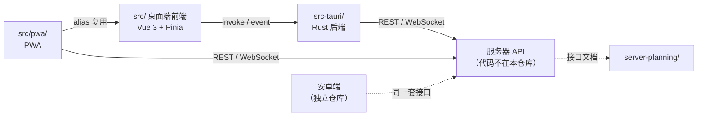

# 项目结构总览（自动生成）

> **不要手改。** 本文件由 `npm run docs:map` 扫描代码生成。
> 版本、目录、模块清单都以代码为准；手写文档只写“范围”和“入口”。
> CI 会运行 `npm run docs:check`，本文件与代码不一致时会失败。

当前 `package.json` 版本：`4.8.0`。

## 1. 仓库范围

本仓库包含：桌面端（`src/` + `src-tauri/`）、PWA 专属层（`src/pwa/`）、
服务器接口文档（`server-planning/`）、UI 工具、脚本与项目文档。

不包含：服务器运行代码（在服务器上维护）、安卓端代码（独立仓库）。

## 2. 目录与入口

| 目录 | 作用 | 入口文档 |
|---|---|---|
| `src/` | 桌面端前端：Vue 3 组件 / Pinia store / Tauri invoke 封装 | [src/README.md](../src/README.md) |
| `src-tauri/` | 桌面端后端：Tauri commands、纯 Rust 业务模块 | [src-tauri/README.md](../src-tauri/README.md) |
| `src/pwa/` | PWA 专属层：复用 `src/`，替换 `@tauri-apps/api` 为浏览器 shim | [src/pwa/README.md](../src/pwa/README.md) |
| `server-planning/` | 服务器接口文档（运行代码不在本仓库） | [server-planning/README.md](../server-planning/README.md) |
| `tools/ui/` | UI 截图 / 布局审计 / 真实窗口驱动 | [tools/ui/README.md](../tools/ui/README.md) |
| `scripts/` | 构建、P2P 联调、留言板、文档/版本检查脚本 | [scripts/README.md](../scripts/README.md) |
| `docs/` | 架构、模块、安全、排错与历史文档 | [docs/README.md](../docs/README.md) |
| `music-player/` | 内置音乐资源与标签 | [music-player/README.md](../music-player/README.md) |
| `deprecated/` | 冻结的历史归档，不改不删 | [deprecated/README.md](../deprecated/README.md) |
| `.local/` | 本机/服务器私密区（仅 README 入库） | [.local/README.md](../.local/README.md) |

## 3. 架构（由代码结构生成）



## 4. 版本快照

| 文件 | 字段 | 版本 |
|---|---|---|
| `package.json` | version | `4.8.0` |
| `package-lock.json` | version | `4.8.0` |
| `package-lock.json` | packages[""].version | `4.8.0` |
| `src-tauri/Cargo.toml` | [package] version | `4.8.0` |
| `src-tauri/Cargo.lock` | pomo-solo version | `4.8.0` |
| `src-tauri/tauri.conf.json` | version | `4.8.0` |
| `src/pwa/config.ts` | PWA_VERSION（独立于桌面端） | `0.5.0` |

> 桌面端版本是同一套值；PWA 的 `PWA_VERSION` 独立，只在发布 PWA 时更新。

## 5. 代码规模（扫描快照）

| 指标 | 数量 | 扫描路径 |
|---|---:|---|
| 前端 API 封装 | 19 | `src/api/*.ts` |
| Pinia stores | 7 | `src/stores/*.ts` |
| Vue 组件 | 38 | `src/components/**/*.vue` |
| Tauri command 文件 | 15 | `src-tauri/src/commands/*.rs` |
| Rust module 文件 | 7 | `src-tauri/src/modules/*.rs` |
| 前端测试文件 | 61 | `src/**/*.test.ts` |

> 这里只统计结构规模，不代替测试结果。测试请运行 `npm test` / `cargo test --lib`。

## 6. 后端模块清单

### Tauri commands（15）

- `ai.rs`
- `charts.rs`
- `cloud_auth.rs`
- `data.rs`
- `foreground.rs`
- `garden.rs`
- `music_sync.rs`
- `music.rs`
- `p2p.rs`
- `study_room.rs`
- `sync.rs`
- `system.rs`
- `timer.rs`
- `update.rs`
- `window.rs`

### Rust modules（7）

- `audio_player.rs`
- `cloud_auth.rs`
- `data_manager.rs`
- `downloader.rs`
- `foreground_inspection.rs`
- `server_api.rs`
- `ws.rs`

## 7. 维护方式

```bash
npm run docs:map      # 重新生成本文件
npm run docs:check    # 校验本文件、版本号、必需 README
npm run versions:check
```

> 根 README / AGENTS 不写目录树、版本号、测试数量；需要整体视图时读本文件。
